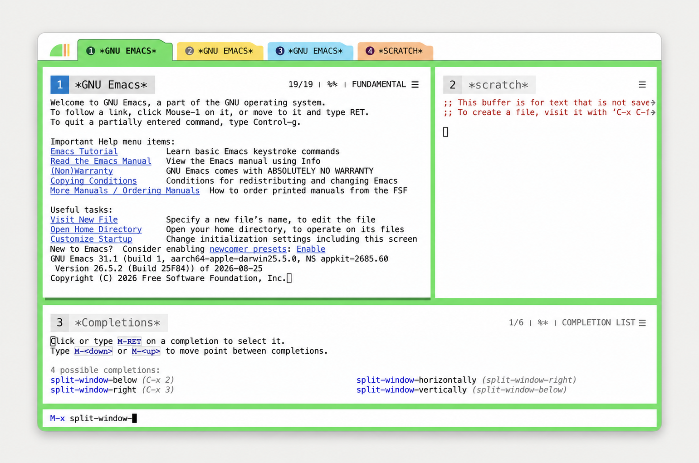
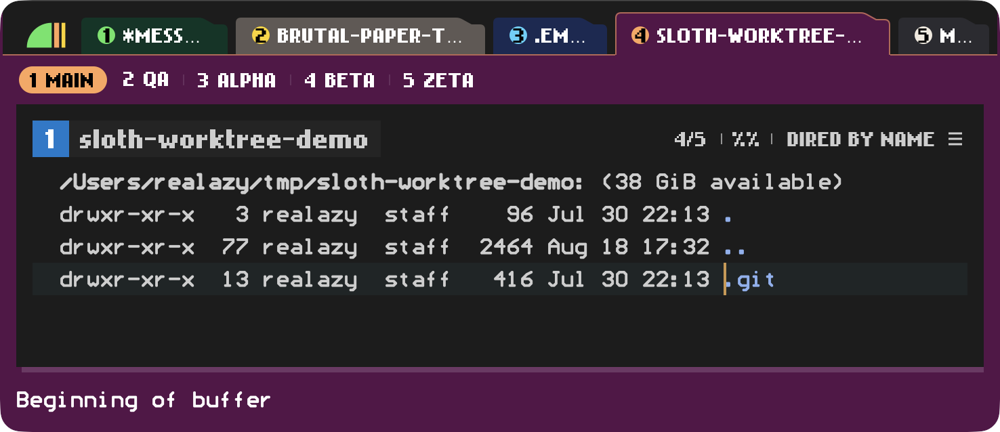

# Emacs Brutal Paper

<picture>
  <source media="(prefers-color-scheme: dark)" srcset="screenshots/emacs-brutal-paper-dark.png">
  <source media="(prefers-color-scheme: light)" srcset="screenshots/emacs-brutal-paper-light.png">
  
</picture>

Brutal Paper is a global structural UI enhancement for GNU Emacs. It layers
paper windows, hard offset shadows, workspace tabs, per-window identity rows,
and a padded echo area over the colour theme you already use.

It deliberately leaves the `default` face alone: font family, font size,
foreground, and editing background remain user choices. Structural colours
are derived from the active colour theme unless explicitly customized.

## Requirements

- GNU Emacs 31.1 or newer
- A graphical Emacs frame with SVG support; terminal frames are unsupported

CI runs the test suite with stable and development Emacs Plus app bundles on
macOS.

Enabling `brutal-paper-mode` signals a user error outside a graphical frame.
Guard the call with `display-graphic-p` in configuration shared with terminal
or batch Emacs.

## Optional macOS frame chrome

On macOS, [Emacs Plus](https://github.com/d12frosted/homebrew-emacs-plus) is
recommended if you want the rounded, button-free frame shown in the
screenshots. It is not required: Brutal Paper works with other supported
graphical Emacs builds, but native window buttons and corner geometry depend
on the distribution and platform port.

## Installation

Install the latest revision with `use-package`:

```emacs-lisp
(use-package brutal-paper
  :vc (:url "https://github.com/cxa/emacs-brutal-paper.git"
       :rev :newest)
  :config
  (when (display-graphic-p)
    (brutal-paper-mode 1)))
```

For a development checkout, add the repository root to `load-path`:

```emacs-lisp
(add-to-list 'load-path "/path/to/emacs-brutal-paper")
```

## Usage

Load your colour theme first, then enable the structural mode:

```emacs-lisp
(load-theme 'modus-operandi t)
(require 'brutal-paper)
(brutal-paper-mode 1)
```

Restore the UI state captured before activation with:

```emacs-lisp
(brutal-paper-mode -1)
```

Brutal Paper remains outside `custom-enabled-themes` and follows later colour
theme changes automatically. It also tracks window splits, selected windows,
tab changes, and minibuffer height changes without assigning a font itself.

## Customization

Run `M-x customize-group RET brutal-paper RET` for all options. Common settings
include:

```emacs-lisp
(setq brutal-paper-window-gap 10
      brutal-paper-fringe-width 12
      brutal-paper-minibuffer-vertical-padding-ratio 0.5
      brutal-paper-shadow-depth 4
      brutal-paper-shadow-mix '(:light 0.38 :dark 0.16)
      brutal-paper-canvas-mix 1.0)
```

`brutal-paper-window-gap` is the single source for the left, inter-window,
right, and tab-to-Paper Canvas gutters. Native outer margins are whole font
columns, so Brutal Paper rounds the requested pixels to the nearest realizable
column width and reuses that exact pixel result everywhere. This keeps all
four gutters equal across fonts. While the mode is active, the frame's internal
border width is zero; disabling the mode restores its previous value.

`brutal-paper-minibuffer-vertical-padding-ratio` is applied to the realized
default font pixelsize; its default `0.5` leaves half a font size above the
prompt and the same amount below the completion body. It does not depend on
the horizontal `brutal-paper-fringe-width`.

`brutal-paper-minibuffer-right-padding` controls the inset for right-aligned
completion annotations. Its default `auto` derives the nearest text-column
count from the left pixel inset and the realized space width. Brutal Paper
applies that value through Marginalia's text alignment instead of reserving a
native window margin: the Paper body and outer Canvas edge therefore stay
continuous at every candidate row and font size.

Palette, typography, and geometry use `brutal-paper-*` Custom options. The
shipped defaults reproduce the reference appearance and can be changed
independently, for example:

```emacs-lisp
(setq brutal-paper-window-title-active-background
      '(:light "#e0e0e0" :dark "#303030")
      brutal-paper-window-title-inactive-background
      '(:light "#f0f0f0" :dark "#242424")
      brutal-paper-tab-colors
      '((:light "#57E561" :dark "#00402A")
        (:light "#FED413" :dark "#7B716B")
        "#4DD1FB")
      brutal-paper-current-tab-font 'bold
      brutal-paper-inactive-tab-font nil ; follow the default face
      brutal-paper-current-title-font nil
      brutal-paper-inactive-title-font nil
      brutal-paper-tab-font-size 12
      brutal-paper-tab-left-padding 12
      brutal-paper-tab-right-padding 18
      brutal-paper-tab-paper-min-contrast 1.2
      brutal-paper-window-title-font-size 16
      brutal-paper-tab-corner-radius 4
      brutal-paper-tab-row-height 41
      brutal-paper-tab-junction-width 1
      brutal-paper-sub-tab-font-size 12
      brutal-paper-sub-tab-subtitle-font-size 10
      brutal-paper-sub-tab-subtitle-color-mix 0.72
      brutal-paper-window-title-height 45
      brutal-paper-svg-text-fallback-baseline-ratio 0.22
      brutal-paper-svg-text-optical-bias-ratio 0.25
      brutal-paper-window-footer-gap-height 12)
```

`brutal-paper-show-window-title-metadata` controls the position, status, mode,
and menu cells on the right of each window title.  Make it buffer-local and
set it to `nil` when a helper buffer only needs its order and title.
`brutal-paper-show-window-title-position` and
`brutal-paper-show-window-title-status` hide just the line position or the
modified and read-only state, with their separators, keeping the mode and menu;
both may be buffer-local too, such as in a terminal where neither means much.
`brutal-paper-show-window-title-mode` independently hides the mode name and
its separator. It can be buffer-local while position and menu remain visible.

Set `brutal-paper-window-title-position-function` buffer-locally to replace
the line position with metadata such as a preview's viewport dimensions. The
function receives the window and returns a string or nil. Custom position
text takes priority over a long buffer name in narrow windows.

For a custom single-row toolbar, make `brutal-paper-tab-line-format` buffer-local.
`brutal-paper-window-number-string` returns a themed number badge with the normal
title-row height, ready to compose with standard mode-line constructs. It draws
no buffer name, metadata or outer margins; the consumer owns the rest of its row.

Every colour option accepts either one colour string for both appearances or
an appearance pair in the form `(:light LIGHT :dark DARK)`. Lists such as
`brutal-paper-tab-colors` apply the same rule to each item. The pair is resolved
from the realized frame background, so changing colour themes and calling
`brutal-paper-apply` refreshes all derived SVG and face colours. The default
window-title pair keeps the active theme's foreground readable in both light
and dark appearances. Tab surfaces that would visually merge with Paper are
shifted by the smallest amount needed to reach
`brutal-paper-tab-paper-min-contrast`; set it to `1.0` when exact palette
values are more important than surface separation.

The parent-row rule uses the selected parent tab's surface colour in every
layout. The line skips that tab's body, leaving its bottom open; when sub-tabs
are visible, the opening flows directly into their row.
`brutal-paper-tab-junction-width` controls the line thickness. Sub-tab
descriptions have an independent size and ink strength, so separators can
remain faint without making descriptive text hard to read.

Parent tabs share the frame width after the logo or hidden-logo spacer. When
their natural widths no longer fit, qualifiers disappear first, titles shorten
with an ellipsis, and the narrowest form keeps only the numbered badge. Badge
geometry and padding remain stable, so all parent tabs stay on one row without
distorting their numbers. If even the complete set of number-only cells cannot
fit, Brutal Paper hides overflow tabs instead of wrapping them into the sub-tab
line; the visible range is contiguous and always contains the current tab.

Selected and inactive parent tabs share one derived content center, keeping
their numbers and labels on the same horizontal line. Text baselines are
derived from the selected font's line height, ascender, descender, and realized
size instead of a fixed vertical correction. The surplus line-box height also
adds a proportional optical bias, keeping compact uppercase labels and numbers
from appearing top-heavy; `brutal-paper-svg-text-optical-bias-ratio` controls
its strength. A parent tab's order number is centered separately from its
label using the digit ink box, so it remains centered inside the round badge.

Current and inactive tabs and window titles each have an independent font
source. A face supplies family, weight, and slant; the pixel size remains
controlled by the existing tab, title, and metadata size options. The selected
tab defaults to the built-in `bold` face, while the other three sources follow
the default face:

```emacs-lisp
(setq brutal-paper-current-tab-font 'my-selected-tab-face
      brutal-paper-inactive-tab-font "Iosevka Aile"
      brutal-paper-current-title-font 'my-selected-title-face
      brutal-paper-inactive-title-font 'fixed-pitch)
(brutal-paper-apply)
```

A family string uses normal weight and slant. A face supplies its family,
weight, and slant. Leave any source as `nil` to follow the `default` face.

Sub-tabs use the parent-tab fonts by default. Set
`brutal-paper-current-sub-tab-font` and `brutal-paper-inactive-sub-tab-font` to
give them their own source; `nil` follows the `default` face and `:tab` returns
to the parent-tab font.
Centered SVG labels derive one shared alphabetic baseline from the selected
font's actual line metrics, so changing family, face, or size does not require
a matching y-offset. `brutal-paper-svg-text-fallback-baseline-ratio` is used
only when an Emacs font backend cannot provide font metrics.
After changing attributes on a selected face directly, call
`brutal-paper-apply` to refresh retained Canvas buffers and invalidate rendered
SVG labels.

Changing palette, typography, or spacing through Customize refreshes Canvas
images, SVG caches, and live frames automatically. On Emacs 32+, flat fills,
gutters, minibuffer spacing, and footer shadows reuse Canvas image objects and
refresh them in place. Emacs 31 uses static SVG for those surfaces. Text,
curved tab artwork, and the logo remain SVG. Line-format options are installed
in live buffers automatically.
After changing several options with `setq`, call `brutal-paper-apply` once.
Options that control native modes (`brutal-paper-enable-tab-bar`,
`brutal-paper-enable-tab-line`, `brutal-paper-hide-tool-bar`,
`brutal-paper-hide-scroll-bars`, and `brutal-paper-rounded-frame-chrome`) are
read when the mode is enabled; disable the mode before changing them, then
enable it again.

`brutal-paper-mode-line-format` is the complete buffer-local
`mode-line-format` installed while the structural layer is active. It accepts
any ordinary mode-line construct; Brutal Paper does not wrap, append to, or
reinterpret it. For example:

```emacs-lisp
(setq brutal-paper-mode-line-format
      '("%e"
        mode-line-front-space
        mode-line-buffer-identification
        "  "
        mode-line-position
        mode-line-end-spaces))
(brutal-paper-apply)
```

A fully custom format replaces the built-in blank footer and its lower hard
shadow. Erase the variable's customization to restore its standard footer.
Customize applies the new format to live buffers immediately; `setq` followed
by `brutal-paper-apply` does the same. Disabling Brutal Paper restores every
buffer's format from before the original enable.

You can override the derived colours with
`brutal-paper-canvas-background`, `brutal-paper-accent-color`, and
`brutal-paper-shadow-color`. `brutal-paper-tab-bar-background` fills the whole
parent row; nil follows Paper, while a function receives the current public tab
item and returns a colour specification.

Without an explicit `brutal-paper-shadow-color`, Brutal Paper evaluates both
light and dark contrast inks against Paper and Canvas, then uses the more
visible polarity. `brutal-paper-shadow-mix` accepts one number or separate
`(:light LIGHT :dark DARK)` strengths; the defaults retain a traditional dark
shadow in light themes and a restrained lighter shadow where darkening has no
remaining contrast.

The workspace row uses the bundled borderless circular-page mark by default: a
square green page with an exact quarter-circle edge beside warm red and yellow
page edges. It desaturates when its frame loses focus. Replace it with any SVG,
add horizontal breathing room, or hide it entirely. Logo height follows the
current 22-pixel chrome scale and is automatically capped at the inactive-tab
height. Width always follows the SVG's intrinsic `viewBox` (or `width` and
`height`) ratio, so logo sizing is deliberately not configurable:

```emacs-lisp
(setq brutal-paper-logo-file "/path/to/my-logo.svg"
      brutal-paper-logo-horizontal-padding 10
      brutal-paper-logo-tab-gap 4
      brutal-paper-logo-vertical-offset -1
      brutal-paper-unfocused-logo-saturation 0
      brutal-paper-show-logo t)
```

Set `brutal-paper-show-logo` to `nil` before enabling to omit the artwork. A
minimal structural spacer remains so the first tab aligns with the paper's
left edge. When Brutal Paper is already active, use Custom or apply the change
explicitly:

```emacs-lisp
(setq brutal-paper-show-logo nil)
(brutal-paper-apply)
```

### Caveat: scroll-bar modes

On macOS NS builds, a native vertical scroll bar occupies a full-height frame
gutter.  That gutter continues through the echo area into the native rounded
bottom corner, where Emacs does not let faces paint the Canvas colour.
The result is a paper-coloured side strip and a square white notch at the
corner.  The NS port also ignores the X-only scroll-bar face colours for this
surface.

For that reason `brutal-paper-hide-scroll-bars` defaults to `t` and keeps both
vertical and horizontal scroll bars disabled while Brutal Paper is active.
Calls to `scroll-bar-mode`, `set-scroll-bar-mode`, and
`horizontal-scroll-bar-mode` cannot re-enable them until the mode is disabled.
Disabling Brutal Paper restores the exact modes captured before activation.

Users who accept the native frame-gutter caveat can opt out before enabling:

```emacs-lisp
(setq brutal-paper-hide-scroll-bars nil)
(brutal-paper-mode 1)
```

With the option set to `nil`, Brutal Paper preserves the current modes and
allows later public mode changes.  Directly mutating frame scroll-bar
parameters bypasses the public mode API and may leave window margins stale
until the next Brutal Paper geometry refresh.

The active window's hard shadow is intentionally limited to the lower footer.
Every window edge uses native Emacs window geometry; Brutal Paper does not
create child frames. An exact right-edge shadow strip is omitted because it
would require a separately composited surface that can visibly jitter during
scrolling and live resize on macOS.

## Embedding

The supported embedding interface is deliberately small:

- configure the `brutal-paper-*` Custom options;
- supply logical parent tabs and optional sub-tabs with
  `brutal-paper-tab-model-function`;
- enable or disable the enhancement with `brutal-paper-mode`;
- reapply changed options and geometry with `brutal-paper-apply`;
- refresh rendered native tab data without reapplying paper/window geometry with
  `brutal-paper-refresh`;
- style an open minibuffer again as a native prompt with
  `brutal-paper-style-minibuffer`, after the consumer gives the prompt back to
  the minibuffer window;
- resolve structural colours with `brutal-paper-canvas-color` and
  `brutal-paper-hard-shadow`;
- match a window's chrome with `brutal-paper-window-style` and
  `brutal-paper-window-footer-image`;
- give one buffer its own footer with a buffer-local
  `brutal-paper-mode-line-format`;
- put a picture in one buffer's title badge, in place of the window order, with
  a buffer-local `brutal-paper-window-title-badge-function`;
- replace one buffer's title metadata with a buffer-local
  `brutal-paper-window-title-position-function`, or hide parts of it with
  `brutal-paper-show-window-title-position`, `-status` and `-mode`;
- draw a custom title row around `brutal-paper-window-number-string`, the
  window's number badge alone.

`brutal-paper-tab-model-function` receives the frame being rendered and
returns `(:tabs TABS :sub-tabs SUB-TABS)`. Each item is a plist containing a
stable `:id`, a `:name`, `:current`, and an inactive `:select` command;
`:subtitle`, `:help`, and `:status` are optional. Status names and their icon,
face, and text fallback come from `brutal-paper-tab-statuses`; the defaults are
`running`, `success`, and `error`. The `running` dots cycle from one to three
inside a fixed-width marker. Badge colours use the configured face's foreground
from the active colour theme, while the icon automatically uses readable ink
against that colour. A sub-tab row is shown only when it has more than one
item. The consumer owns data and selection behavior, while
Brutal Paper owns all layout, colors, typography, sizing, and redisplay:

```emacs-lisp
(setq brutal-paper-tab-model-function #'my-workspace-tab-model)
(brutal-paper-refresh)
```

Custom states reuse the built-in `dots`, `check`, `cross`, or `dot` drawings:

```emacs-lisp
(setq brutal-paper-tab-statuses
      '((busy :icon dots :face warning :label "...")
        (ready :icon check :face success :label "✓")
        (blocked :icon cross :face error :label "✗")))
```

The model function should be fast and side-effect-free. Call
`brutal-paper-refresh` after its data changes. Leave the option nil to render
Emacs's native physical tabs without a sub-tab row. Refresh also owns the
native tab-bar line count so the consumer's second row remains explicit.
Text published through Emacs's `global-mode-string` is rendered at the right
edge of the parent row.

### Drawing matching chrome

A package that draws its own rows inside a paper window, such as a toolbar
in the footer, reads Brutal Paper's presentation instead of its options:

```emacs-lisp
(brutal-paper-window-style)          ; the selected window, or pass one
;; => (:active t :paper "#ffffff" :canvas "#e8e8e8" :ink "#000000"
;;     :title-background "#e0e0e0" :title-ink "#000000"
;;     :title-height 45 :title-block-top 12 :title-block-height 27
;;     :title-bottom-inset 6)
```

`:active` and the title colours follow the same rule as the window's own
title row, so call it from a mode-line or tab-line construct to match the row
being drawn. `:title-bottom-inset` is the blank height below the title block,
for aligning content under it.

`brutal-paper-window-footer-image` returns the built-in footer (paper, Canvas
gap and hard shadow) for a window, to compose content above it. It's an SVG
image on Emacs 31 and a Canvas image on Emacs 32 and later, which has no SVG
data to embed; it's nil when the frame can't display images.

To put that content in one buffer's footer, give the buffer a local footer
format; Brutal Paper installs it there and keeps it through theme changes and
refreshes:

```emacs-lisp
(setq-local brutal-paper-mode-line-format '((:eval (my-footer))))
```

Kill the local value, then call `brutal-paper-apply`, to return the buffer to
the global footer.

A buffer can show a picture in its title's order badge instead of the window
number, such as an icon of what it holds. The function gets the badge's
`:size`, `:ink` and `:background` and whether the window is `:active`, and
returns the image to draw centred there, or nil for the number:

```emacs-lisp
(setq-local brutal-paper-window-title-badge-function
            (lambda (style)
              (list :type 'svg :data (my-icon-svg (plist-get style :ink))
                    :width 14 :height 14)))
```

Titles are cached by the returned value, so return an equal value for an
unchanged picture and memoize the drawing.

To keep the window number and add a device or content icon beside it, set
`brutal-paper-window-title-icon-function` instead. It uses the same callback
contract, but draws an additional square between the order badge and title.
The square is a lighter shade of the title background in both light and dark
appearances. The icon remains visible during numbered window selection.

Window selection keyed by the order numbers, such as ace-window's, can bind
`brutal-paper-window-title-show-order` to show every number meanwhile:

```emacs-lisp
(define-advice aw-select (:around (select &rest arguments) show-orders)
  (let ((brutal-paper-window-title-show-order t))
    (force-mode-line-update t)
    (unwind-protect (apply select arguments)
      (force-mode-line-update t))))
```

### Advanced tab model: projects and worktrees

A consumer can use the parent row for logical project groups and the optional
second row for the selected project's physical Git worktrees. The workspace
layer owns project discovery and navigation; Brutal Paper receives only
presentation data and commands:



```emacs-lisp
;; This example relies on lexical binding so click commands retain FRAME and ID.
;; The consumer supplies these four domain functions:
;;
;;   (my-workspace-groups FRAME)
;;     => ((:id ID :name NAME :current BOOL) ...)
;;   (my-current-worktrees FRAME)
;;     => ((:id ID :name BRANCH :description TEXT
;;          :directory DIRECTORY :current BOOL) ...)
;;   (my-select-workspace ID)
;;   (my-visit-worktree DIRECTORY)

(defun my-brutal-paper-tab-model (frame)
  "Expose logical workspaces and worktrees on FRAME."
  (with-selected-frame frame
    (let ((groups (my-workspace-groups frame))
          (worktrees (my-current-worktrees frame)))
      (list
       :tabs
       (mapcar
        (lambda (group)
          (let ((id (plist-get group :id))
                (name (or (plist-get group :name) ""))
                (current (plist-get group :current)))
            (append
             (list :id id
                   :name name
                   :current current
                   :help (format "Select workspace %s" name))
             (unless current
               (list
                :select
                (lambda ()
                  (interactive)
                  (when (frame-live-p frame)
                    (with-selected-frame frame
                      (my-select-workspace id)))))))))
        groups)
       :sub-tabs
       (mapcar
        (lambda (worktree)
          (let ((id (plist-get worktree :id))
                (name (or (plist-get worktree :name) ""))
                (description (plist-get worktree :description))
                (directory (plist-get worktree :directory))
                (current (plist-get worktree :current)))
            (append
             (list :id id
                   :name name
                   :subtitle description
                   :current current
                   :help (format "Visit worktree %s" name))
             (unless current
               (list
                :select
                (lambda ()
                  (interactive)
                  (when (frame-live-p frame)
                    (with-selected-frame frame
                      (my-visit-worktree directory)))))))))
        worktrees)))))

(setq brutal-paper-tab-model-function #'my-brutal-paper-tab-model)
(brutal-paper-refresh)
```

Use persistent domain identities for `:id`, such as a normalized project root,
Git common directory, or worktree root. Do not use a mutable display label: the
ID is part of Brutal Paper's render cache. Exactly one item in each populated
row should have `:current` non-nil, and only inactive items need `:select`.
Selection callbacks must be interactive commands and should select the frame
for which the model was built before changing consumer state.

The second row is rendered only when `:sub-tabs` contains at least two items.
It is therefore safe for the model to return nil or the sole current worktree.
Call `brutal-paper-refresh` from the consumer's own project/worktree change
hook after cached names, descriptions, ordering, or membership changes. Pass a
frame when the update is frame-local:

```emacs-lisp
(defun my-workspace-model-changed (&optional frame)
  (when (bound-and-true-p brutal-paper-mode)
    (brutal-paper-refresh frame)))
```

Ordinary native tab selection and creation are already observed by Brutal
Paper. Use `brutal-paper-apply` instead only when visual options or paper/window
geometry changed.

Functions and variables whose names contain `--` are implementation details
and may change without notice.

## Development

Run the complete suite with any supported Emacs executable:

```sh
make check EMACS=/path/to/emacs
```

On macOS, launch every discovered supported GNU Emacs app bundle with the same
visual acceptance fixture:

```sh
make e2e
```

The script finds Emacs 31+ bundles with the `org.gnu.Emacs` identifier through
Spotlight, `~/Applications`, `/Applications`, and Homebrew's detected `opt`
directory. Every ten seconds, each fixture rotates among its available
built-in light/dark colour themes and installed monospaced fonts, together with
the active/inactive window-title colour pair. Parent and sub-tab status badges
remain active between presentation changes. The launcher prints its random seed;
set `BRUTAL_PAPER_E2E_SEED` to that value to replay the same sequence on the
same set of apps and fonts.

`make check` runs ERT, checks the E2E launcher, and byte-compiles with warnings
treated as errors.

## License

GNU General Public License version 3 or later. See [LICENSE](LICENSE).
